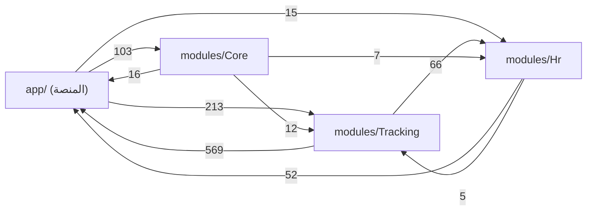
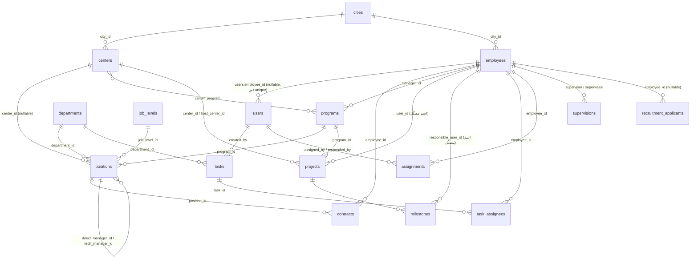

# HC-Hub — تدقيق الوضع الحالي (2026-11-16)

قراءة فقط: لم يتغيّر شيء في الكود ولا في القاعدة. المصدر: الكود، الـ migrations، واستعلامات `SELECT` على `hc_hub`.
الباقي: [القرارات](decisions.md) · [التصميم المستهدف](02-target-design.md) · [خارطة الطريق](03-roadmap.md).
ما كُتب بجانبه **غير مؤكّد** لم يُفتح ملفه أو لم يُفحص في القاعدة.

## 1. خريطة المعمارية الحالية

**الخلاصة:** تمّ الدمج البرمجي في 2026-11-11. تطبيق واحد، قاعدة واحدة، ثلاث وحدات. لكن الطبقات مقلوبة: `Core` يستورد من الوحدات، والمنصة (`app/`) تستورد من `Tracking` بكثافة.

| البند | القيمة |
| --- | --- |
| PHP / Laravel | 8.5 / 13.34 |
| Livewire / Flux / Blaze | 4.4.7 / 2.20.1 / 1.0.19 |
| Tailwind / Vite | 4 / 8 (`vite-plus`) |
| Auth | Fortify 1.40 (2FA, passkeys) |
| الصلاحيات | `spatie/laravel-permission` 8.3 |
| البث | Reverb 1.12 + `laravel-echo` |
| AI | `laravel/ai` 1.3 (المزوّد الافتراضي `ollama`، `config/ai.php:16`) |
| الاختبارات / التحليل | Pest 5.2 / Larastan 3.12 (level 7) |
| الطوابير، الكاش، الجلسات | `database` (`.env.example:68-87`) |

**ترتيب الـ providers** (`bootstrap/providers.php`): `AppServiceProvider` ← `FortifyServiceProvider` ← `CoreServiceProvider` ← `TrackingServiceProvider` ← `HrServiceProvider`.

**نمط الصفحات:** تستخدم الوحدتان صفحات Livewire بملف واحد ("⚡") عن طريق `Route::livewire` (`HrServiceProvider.php:62`, `TrackingServiceProvider.php:60`). كل الصفحات على `layouts::desk`.

### اتجاه الاعتماد الفعلي (عدد جمل `use`)

| الملاحظة | الدليل |
| --- | --- |
| `Tracking → Hr` هو الغالب: `Employee` ×51، `Department` ×11، `Position` ×2، `Contract` ×2 | 66 جملة في 74 ملفاً |
| حلقة حقيقية على `Employee` | `modules/Hr/Models/Employee.php:34-38` يستورد `AnnualPlan`, `Milestone`, `Project`, `Task`, `TaskAssignee` |
| `Core` ليس طبقة أساس | `modules/Core/Models/User.php:8-44`, `Program.php:24-31`, `Center.php:22-23`, `City.php:19-20` |
| المنصة تعرف `Tracking` بالاسم | 23 من 47 ملفاً في `app/Support/Desk`؛ 138 استيراد Models و 56 Enums |
| "السجل" (registry) هو استيراد مكتوب يدوياً | `app/Support/Desk/Destinations.php:10,369`, `Panels.php:12,1002` |

## 2. جرد الوحدات

| الوحدة | ماذا تملك | PHP (سطر) | Blade (سطر) | Models |
| --- | --- | --- | --- | --- |
| `app/` (المنصة) | الدخول، الـ layout، القائمة، الـ Desk، الصلاحيات، السجل، الإشعارات، الملفات، AI | 22,960 | 20,061 (`resources/views`) | 10 |
| `modules/Core` | `User`, `Program`, `City`, `Center` | 1,567 | – | 4 |
| `modules/Hr` | الموظفون، العقود، المناصب، الإجازات، التوظيف، الرحلات، الأخبار، الأرشيف | 68,728 | 25,274 | 90 ملفاً |
| `modules/Tracking` | الاستراتيجية، شاشات إدارة البرامج (الموديل في Core)، المشاريع، المهام، المراحل، النتائج، المخاطر، التمويل، التقارير | 80,837 | 45,185 | 62 ملفاً |

### الفرق في الشكل الداخلي

| | HR | Tracking |
| --- | --- | --- |
| صفحات "⚡" | 67 | 45 (+5 مكوّنات) |
| Livewire concern traits | 26 | 141 |
| `*Service.php` | 40 | 0 |
| Support classes | 155 | 47 |
| ملفات routes | 18 (ملف لكل مجال) | 1 (`web.php`, 292 سطراً) |
| Migrations | 16 في `modules/Hr/database/migrations` | 0 في الوحدة؛ 177 في `database/migrations` |
| Policies | 42 | 27 |

### الـ routes

| البند | القيمة |
| --- | --- |
| المجموع | 229، منها 126 صفحة Livewire (74 `hr.*`، 52 غيرها) |
| HR | 98 رابطاً تحت `/hr/*`، 105 أسماء تحت `hr.*` |
| HR العامة | `careers/{token}` (5، `modules/Hr/routes/public/careers.php:15-28`)، `ID/{card}` (2، `public/employee-cards.php:13-19`) |
| Tracking | بدون بادئة في الرابط ولا في الاسم (`/projects`, `/tasks`, `admin/*`)؛ `TrackingServiceProvider.php:41` |
| المنصة | `/home`, `/activity`, `/notifications`, `admin/users`, `settings/security` |
| اللغة | بدون بادئة `/en` `/ar`. تتغيّر عبر `POST locale` (`routes/web.php:24`) |
| API | لا يوجد `routes/api.php`. `/up` للفحص (`bootstrap/app.php:24`). لا توجد webhooks |

### الاختبارات

| البند | العدد |
| --- | --- |
| ملفات الاختبار | 463 |
| `tests/Feature/Hr` | 14 |
| تذكر `Modules\Hr` | 35 |
| تذكر `Modules\Tracking` | 356 |
| تذكر الاثنتين | 14 |

HR يشكّل تقريباً 46% من كود الوحدات، وأقل من 10% من الاختبارات.

## 3. قاعدة البيانات والعلاقات

قاعدة واحدة `hc_hub`: 184 جدولاً، 381 FK. الأعداد الحية في جدول [القرارات](decisions.md).

### قلب الناس والهيكل والمشاريع

### القاعدة: المسؤول = موظف، الفاعل = مستخدم

مكتوبة في `database/migrations/2026_09_14_145609_move_assigned_people_to_hr_employees.php:25-30`.

| النوع | يشير إلى | أمثلة |
| --- | --- | --- |
| المسؤول عن العمل | `employees.id` | `programs.manager_id`, `annual_plans.manager_id`, `assignments.employee_id`, `task_assignees.employee_id`, `meal_coverages.employee_id`, `proposal_reviewers.employee_id`, `proposal_locations.responsible_employee_id`, `donor_reports.responsible_employee_id`, `supervisions.*_employee_id` |
| من قام بالفعل | `users.id` | `tasks.created_by`, `reports.user_id`, `indicator_progress.recorded_by`, كل `uploaded_by`, `monthly_reports.prepared_by/submitted_by/validated_by/returned_by`, `donors.requested_by/approved_by`, `proposal_status_notes.changed_by` |

### الشذوذ

| المشكلة | الدليل |
| --- | --- |
| عمودان اسمهما `*user_id` ويخزّنان رقم موظف | `projects.user_id` (`modules/Tracking/Models/Project.php:332`)، `milestones.responsible_user_id` (`Milestone.php:335`) |
| HR نفسه يخلط القاعدة | `leave_requests.approved_by` ← `employees`، `evaluations.current_manager_id` ← `employees`، لكن `*_by` في الرحلات ← `users` (`2026_11_11_100011_add_hr_foreign_keys.php:59,101,126-149`) |
| الجسر غير مضبوط | `users.employee_id` nullable وعليه index فقط، والعكس `HasOne` (`Employee.php:579-582`). في القاعدة: موظف واحد له حسابان |
| `null` يعني "حساب نظام" فعّالاً دائماً | `modules/Core/Models/User.php:273-282` |
| كل سؤال "ما الذي يخصّني" يقفز user ← `employee_id` | `User.php:472-507` |
| أعمدة شخص بدون FK | `leave_request_notes.author_employee_id`, `monthly_report_lines.entered_by`, `report_template_lines.entered_by`, `courses.granted_by`, `library_indicators.collected_by`, `hr_activity_log.causer_id` |
| migration الـ FK يتخطّى أي عمود فيه صفوف يتيمة | `database/migrations/2026_11_11_100300_add_foreign_keys_to_hr_and_core_references.php:56-67` |

### الأشخاص غير الموظفين

| من | أين | ملاحظة |
| --- | --- | --- |
| جهة اتصال المانح | نص حر على `donors` (`contact_person`, `email`, `phone`) | واحدة لكل مانح، بدون كيان |
| الأقارب | `relatives` | يُحذفون مع الموظف (cascade) |
| المتقدمون | `recruitment_applicants` (فيه `identity_key_hash` وحقول إخفاء الهوية) | 0 صف الآن |
| متطوعون، مستشارون، مجلس الإدارة | صفوف `employees` بنوع عقد أو `is_board_member` | لا يوجد جدول مستشارين (**غير مؤكّد** أبعد من grep) |

التوظيف نسخ + ربط: `RecruitmentHiringConversionService.php:161-199, 509-568` ينشئ موظفاً جديداً أو يربط موظفاً موجوداً (مطابقة بالرقم الوطني أو البريد الإلكتروني أو الهاتف)، ويضع `applicant.employee_id`. صف المتقدم يبقى.

### التاريخ

| ماذا | مؤرّخ؟ |
| --- | --- |
| `contracts` (`position_id`, `start_date`, `end_date`, `terminated_at`) | نعم. هو تاريخ المنصب للشخص |
| `contract_amendments` (`effective_from`, `terms_before/after`) | نعم |
| الرحلات (onboarding, offboarding, renewal)، `badges`, `profile_change_requests` | نعم |
| قسم/مركز/مدير المنصب نفسه | لا. تعديل المنصب يغيّر الماضي |
| `supervisions` | لا. بدون تواريخ، والإزالة حذف نهائي (`RemoveSupervision.php:33`) |
| `assignments` | الصفوف لا تُحذف (superseded)، لكن بدون تاريخ نهاية ولا دور |
| `task_assignees`, `meal_coverages` | الحالة الحالية فقط |
| عضوية مشروع (فريق، دور، من/إلى) | **غير موجودة** |

"المنصب الحالي" مع أكثر من عقد فعّال يُحدَّد بطريقتين مختلفتين: `latestActiveContract` و `primaryContract` (`Employee.php:394-436`؛ تحذير في `app/Support/EmployeeProfile.php:222`).
لا يوجد SoftDeletes على `User` ولا `Employee`. المغادرة = `employees.is_active = false`. الحذف النهائي موجود (`modules/Hr/Actions/Employees/DeleteEmployee.php:36`).

### جداول قديمة ما زالت موجودة

| الجدول | الصفوف | الحالة |
| --- | --- | --- |
| `hr_media` | 334 | **حي**، قراءة وكتابة (`modules/Hr/Support/Employees/HrMedia.php:54-165`). على قرص `hr` الذي يشير إلى `../hc-hr/storage/app` (`config/filesystems.php:58-60`). النوع القديم `App\Models\Employee` (`PresentsEmployee.php:91`). بدون تشفير |
| `hr_activity_log` | 4048 | قراءة فقط في صفحة `/hr/activity` |
| `hr_notifications` | 2171 | لم نجد من يقرؤه |
| `zz_drop_*` (5 جداول) | 22 | موقوفة، لا أحد يقرؤها (`2026_11_11_195801_retire_unused_hr_preference_tables.php:20-26`) |
| اتصال `hr_import` (بادئة `hchr_`) | – | يستخدمه `hub:import-hr` فقط (`config/database.php:67-79`) |

## 4. الوظائف المتداخلة

التصنيف: **Preserve** يبقى · **Consolidate** يُوحَّد · **Refactor** يُعدَّل شكله · **Replace** يُستبدَل · **Deprecate** يُوقَف.

| # | المجال | Tracking / المنصة | HR | الشيء نفسه؟ | التصنيف |
| --- | --- | --- | --- | --- | --- |
| 1 | الصلاحيات | كتالوج `config/access-control.php:16-48` (31 مجموعة)، 9 أدوار، `can()` تراكمي | صلاحيات وأدوار موجودة من الاستيراد فقط (`HrImporter.php:243-313`)، وثلاث helpers: `Settings/HrAccess`, `Employees/HrAccess::is()`, `Recruitment/Access` (الدور الفعّال فقط، `Access.php:17-22,88`) | الغرض نفسه، دلالات مختلفة | Consolidate (D5) |
| 2 | أسماء الأدوار | `General Manager`, `Managers` | `general-manager`, `manager`, `HR-SYR`, `HR-<CITY>` | الأدوار نفسها باسمين | Consolidate |
| 3 | سجل النشاط | `activities` + `RecordsActivity` (29 من 61 موديلاً) | 0 من 89 موديلاً. `ActivityLogger` يكتب في ملف log (`ActivityLogger.php:10-30`)، `RecruitmentRequestEvent`, `RecruitmentPrivacyAudit` | الغرض نفسه | Consolidate (D6)؛ `RecruitmentPrivacyAudit` Preserve |
| 4 | صفحة السجل | `activity.index` | `hr.activity.index` (القديم، قراءة) | مصدران | Preserve القديم للقراءة |
| 5 | الإشعارات | `AppNotification` ← `RecipientResolver` ← `RecipientFilter` ← inbox | تصل إلى الـ inbox نفسه لكنها تتخطّى الـ resolver والفلتر والكتم (`LeaveNotificationService.php:252-266`, `ChecklistNotifier.php:52-68`, `InboxChannel.php:24-48`)؛ 10 كلاسات توظيف | الغرض نفسه | Consolidate (D7) |
| 6 | منع التكرار | `AlertLedger` | `notification_deliveries` (`DeliveryLedger.php:15-20`) | الشيء نفسه | Consolidate |
| 7 | "بانتظاري" | `notifications.index`، بطاقات `needs`/`waiting`، `reviews.index` | `hr.inbox` (`WorkInbox.php:24-35`) | 4 واجهات للسؤال نفسه | Consolidate (D7) |
| 8 | الملفات | `media` مشفّر AES-256-GCM (`app/Models/Media.php:22-36`, `StoredFiles.php:26-36`) | `hr_media` غير مشفّر، بطريقتين للوصول؛ ClamAV في التوظيف فقط | الغرض نفسه | Replace `hr_media` (D8)؛ ClamAV Preserve |
| 9 | التقويم | `calendar.index` (مهام ومراحل) | `hr.leave.team-calendar`, `hr.leave.holidays` | صفحتان منفصلتان. الجسر الوحيد `app/Support/HrHolidays.php` | Consolidate بطبقات (D11) |
| 10 | المهام | `Task`/`TaskAssignee` عمل. `UserTodo` ملاحظات خاصة | `Checklist` = عُهدة معدات (ماركة، رقم تسلسلي، `delivered_at`) | **تشابه في الاسم فقط** | Preserve الكل؛ Refactor الاسم (D11) |
| 11 | سير الموافقات | Actions + enum لكل واحد (Proposal 12 حالة، تقارير، مانح، خطة نشاط) | إجازة، تعديل عقد، ومحرّك توظيف كامل بنسخ (`RecruitmentWorkflow*`) | النمط نفسه، قواعد مختلفة | Preserve (D9) |
| 12 | الإحصائيات | بطاقات Desk وتقارير | 3 صفحات (عدد، عقود، رواتب) | ليست الشيء نفسه | Preserve |
| 13 | صفحة الموظف | `EmployeeProfile` قراءة فقط، `admin/users`, `settings/security` | `hr.employees.show`, `hr/my-profile` | لا توجد روابط بينها (0 مرجع من Tracking و `app`) | Consolidate (D11) |
| 14 | المدن | `admin/cities` خريطة تغطية + MEAL، بدون CRUD | تبويب في إعدادات HR يقوم بالـ CRUD | مدخلان للجدول نفسه | Consolidate المدخل |
| 15 | البرامج والمراكز | `programs.index` | `hr/programs` و `hr/centers` قراءة فقط | الجدول نفسه | Deprecate صفحات القراءة بعد التحقق |
| 16 | الجدولة | `routes/console.php:8-19` (11) | `HrServiceProvider.php:90-119` (16) | الآلية نفسها في مكانين | Refactor (D10) |
| 17 | البحث | شريط "Ask" يبحث في سجلات Tracking (`⚡ask.blade.php:284-315`) | HR يظهر كصفحات فقط، بدون بحث في الموظفين | ناقص | Refactor (مصادر بحث) |
| 18 | AI | `AiGateway` + `ai_requests` | `HrAssistant`, `AnalyzeRecruitmentCv` يستخدمان البوابة نفسها | موحّد أصلاً | Preserve |
| 19 | `Evaluation`, `Course`, `News` | – | تقييم عقد، سجل تدريب، محتوى تحريري بجمهور | ليس لها مقابل | Preserve |

## 5. خريطة اعتماد منطق العمل

| من يعتمد على من | كيف | الدليل |
| --- | --- | --- |
| Tracking ← بيانات الموظف | قراءة مباشرة عن طريق `App\Support\EmployeeProfile` (المكان الحالي، خط الإدارة) | `app/Support/EmployeeProfile.php:13-24, 60-62, 146-148` |
| مدير القسم | مطابقة اسم `job_level` من config، وليس عموداً | `EmployeeProfile.php:97-130`, `config/access-control.php:161` |
| مواعيد Tracking ← عطل HR | `HrHolidays` يغذّي `WorkingCalendar` | `app/Support/HrHolidays.php` |
| حساب الدخول ← العقد | أول عقد فعّال ينشئ `username@hcsyria.org`. يُتخطّى إذا كان الـ username فارغاً أو البريد الإلكتروني مستخدَماً | `modules/Hr/Actions/Contracts/ActivateEmployeeForContract.php:68-99` |
| بريد العمل | يُشتق مرة واحدة ويبقى في `users.email` فقط. قد ينحرف | `Employee.php:767-770` |
| منع الدخول ← حالة الموظف | `hasLostAccess()` + `EnsureAccountIsActive` | `User.php:273-282`, `app/Http/Middleware/EnsureAccountIsActive.php:17-30` |
| إيقاف الموظف | يدوي، أو أمر مجدول بعد آخر عقد + مهلة | `ToggleEmployeeStatus.php:25-34`, `DeactivateDepartedEmployees.php:20-31` |
| الرحلات ← العقود | `JourneyHooks` على أحداث موديل `Contract` | `modules/Hr/Support/Journeys/JourneyHooks.php:14-25` |
| رؤية المهام ← القسم والأدوار | `TaskVisibilityScope` | `modules/Tracking/Models/Scopes/TaskVisibilityScope.php:16-36`, `config/access-control.php:144-146` |
| ملكية المشروع/البرنامج | `ownedProjectIds()` / `managedProgramIds()` | `User.php:482-515`, `ProjectPolicy.php:54` |
| السجل ← الإشعارات | `ActivityRecorder` يكتب ويرسل `FanOutActivity` بعد الـ commit | `app/Notifications/ActivityRecorder.php:25-48`, `app/Jobs/FanOutActivity.php:22-38` |
| أحداث Tracking | 5 أحداث بـ listeners مربوطة يدوياً. `ProposalLocationsChanged` بدون listener | `TrackingServiceProvider.php:96-103` |
| أحداث HR النصية | `hr.employee.account-created`, `hr.folder.shared`, `hr.employee.card-reported-lost`: **لا يوجد listener لأي منها** | `ActivateEmployeeForContract.php:59`, `ManageArchive.php:71`, `ManagesEmployeeProfile.php:202` |
| بين الوحدتين | لا يوجد حدث typed. الربط قراءة مباشرة | – |
| القائمة والـ Desk ← HR | `HrDestinations` و `HrPanels` مستوردان يدوياً. الترتيب الافتراضي حسب الدور مقسوم | `Destinations.php:307-371`, `Panels.php:97-104, 889`, `HrPanels.php:87-97` |
| استيراد HR | `hub:import-hr` يفرّغ ويعيد تحميل كل جداول HR. **بدون حماية في الكود** | `ImportHrCommand.php:21`, `HrImporter.php:111-113, 395` |

**أطراف خارجية:** Cloudflare Turnstile (`app/Support/Turnstile.php:75`)، ClamAV، مزوّدات AI، Reverb، SMTP. مزامنة Google Drive للسياسات لم تُنقل (`HrAssistant.php:17-18`).

**لا يوجد Web Push حقيقي:** `public/sw.js` ليس فيه `push` listener (`:13,15,36`)، و `push_subscriptions` حُذف. الموجود: inbox + toast + إشعار النظام والصفحة مفتوحة. البريد الإلكتروني فقط لـ `MonthlyDigestMail` وتنبيهات الدخول. التفضيلات: كتم حسب الوحدة فقط (`app/Models/NotificationMute.php:14`).

## 6. الميزات التي يجب حفظها

| الوحدة | الميزات |
| --- | --- |
| المنصة | الدخول (2FA، passkeys، رمز البريد الإلكتروني، الأجهزة الموثوقة، تنبيه جهاز جديد)؛ الـ Desk وبطاقاته وترتيبه؛ شريط "Ask" (عربي/إنجليزي)؛ الـ inbox (قراءة، تأجيل، دمج)؛ الماسحات والتنبيهات (10)؛ الملخص الشهري؛ تشفير الملفات والـ keyring؛ السجل والخط الزمني؛ الجولة الإرشادية؛ العربية و RTL |
| Tracking | الاستراتيجيات والركائز؛ إدارة البرامج (الجدول والموديل في Core)؛ الخطط السنوية وخطط النشاط الأسبوعية والتحديثات الشهرية؛ المشاريع (تفعيل، إغلاق)؛ المراحل و Gantt (baseline، dependencies)؛ المهام (لوحة، قائمة، تقويم، مهام الأقسام)؛ النتائج والمؤشرات والأهداف ومكتبة المؤشرات؛ المخاطر ومكتبتها؛ المانحون (موافقة)؛ الـ proposals (12 حالة، مراجعون، أماكن حتى المركز)؛ الاتفاقيات والأقساط؛ التحويلات والحسابات؛ التقارير الشهرية (تقديم، تحقق، إرجاع، إعادة فتح)؛ تقارير المانحين؛ الإسناد والاستلام (`assignments`)؛ تغطية MEAL؛ الإشراف؛ تصدير CSV |
| HR | ملف الموظف والبطاقة الرقمية (`/ID/{card}`)؛ العقود وأنواعها وشرائح الأجر والنص القانوني؛ تعديلات العقود (مسودة، موافقة، تطبيق)؛ المناصب وخطّا الإدارة؛ الإجازات (أرصدة، قواعد، قرار، "بالنيابة"، تسعير، تغطية الفريق)؛ العطل وخيار عيد الميلاد؛ رحلات الانضمام والمغادرة والتجديد؛ العُهد (`Checklist`, `EmployeeItem`)؛ التوظيف (طلبات، محرّك موافقات بنسخ، حملات، موقع الوظائف، متقدمون، مقابلات، تقييمات، عروض، تحويل إلى موظف، تحليل CV، قواعد المؤشرات، خصوصية وإخفاء هوية)؛ الأخبار بالجمهور؛ الأرشيف والمشاركة؛ طلبات تعديل الملف؛ الإحصائيات؛ المساعد؛ الملاحظات |
| Core | `users`, `programs`, `cities` ("Syria" كنطاق عام، id 1), `centers`, `center_program` |

**البرنامج ليس مكرراً:** جدول واحد `programs` وموديل واحد `Modules\Core\Models\Program`. Core يملكه، Tracking يديره من `/programs` ويضيف `strategy_id` و `strategic_pillar_id` و `manager_id`، و Hr يقرؤه فقط من `/hr/programs`.

قاعدة: لا تُزال أي ميزة من هذه ولا تتغيّر قواعدها بدون خطة انتقال واختبار قبلها.

## 7. الدين التقني

### أكبر الملفات (غير الاختبارات)

| السطور | الملف |
| --- | --- |
| 1266 | `resources/views/components/ui/gantt.blade.php` |
| 1069 | `modules/Hr/.../recruitment/indicators/⚡rules.blade.php` |
| 1024 | `modules/Hr/Actions/Recruitment/RecruitmentScopeResolver.php` |
| 1014 | `app/Support/Desk/Panels.php` |
| 976 | `modules/Hr/Actions/Recruitment/RecruitmentInterviewSchedulingService.php` |
| 938 | `modules/Tracking/.../components/proposals/⚡targets.blade.php` |
| 924 | `modules/Hr/Actions/Recruitment/RecruitmentHiringConversionService.php` |
| 922 | `modules/Hr/Support/Leave/LeaveRequestPricing.php` |
| 910 | `modules/Tracking/Support/ResultsChain.php` |
| 841 | `modules/Hr/Support/Leave/TeamCoverage.php` |
| 811 | `modules/Hr/Models/Employee.php` |
| 734 | `modules/Tracking/Models/Project.php` |

كذلك: `lang/en/hr_recruitment.php` 2,652 سطراً؛ `tests/Pest.php` 971؛ `tests/Feature/TaskDirectoryTest.php` 2,182.

### البنود

| البند | التفصيل |
| --- | --- |
| فجوة الاختبارات | HR: 35 ملفاً مقابل 356 لـ Tracking، مع حجم كود متقارب |
| PHPStan | level 7، بدون baseline، `ignoreErrors` في `phpstan.neon` (706 أسطر، 107 قواعد). Blade الوحدات مستثنى |
| أسماء أدوار مكتوبة في الكود | `MonthlyReportPolicy.php:118,166,181`, `PlanUpdatePolicy.php:38,80-104`, `ActivityPlanPolicy.php:77`, `Models/MonthlyReport.php:197,212`، وجداول الربط في HR (`Employees/HrAccess.php:23-28`, `Settings/HrAccess.php:26`). تغيير اسم دور يكسر السلوك بصمت |
| لا يوجد `Gate::before` | Super Admin يأخذ كل الصلاحيات عند الإنشاء (`app/Models/Role.php:34-47`). `permissions:sync` يضيف فقط (`SyncPermissions.php:14-22`) |
| كتم الإشعارات | `leaves` و `recruitment` غير موجودتين في `config/notifications.php:47-70`. هل تسمح صفحة الإعدادات للمستخدم بكتمهما: **غير مؤكّد** |
| تعليقات قديمة | "HR database / no FK" في الـ migrations وفي `Assignment` و `Supervision`؛ docblock `RecruitmentBootstrap.php:30-32` (الـ provider صار يستدعيه في `boot()`، `HrServiceProvider.php:122`)؛ صفحة `/hr/activity` تقول إن التغييرات الجديدة تذهب إلى سجل الـ Hub، وهذا غير صحيح لموديلات HR؛ docblock `DeleteEmployee.php:13-14` يخالف الـ FKs |
| قواعد قديمة | `.ai/rules/index.md` ما زال يربط قواعد بـ `components/navigation/sidebar.blade.php` الذي لم يعد موجوداً. القائمة صارت `components/desk/side-nav.blade.php` |
| كود ميت (متحقق منه) | `modules/Hr/Models/PolicyDocument.php` (0 مرجع)؛ `x-ui.status-strip` (0 مرجع)؛ `x-ui.page-header` (في اختبار فقط)؛ `UserIdRemap` no-op (`UserIdRemap.php:72`) |
| روابط مكسورة | بطاقات HR تشير إلى `hr.team.index` و `hr.leave.holidays.index` (`HrPanels.php:108,110`, `Cards/CalendarCard.php:42,96`, `TeamCard.php:31`, `NextHolidayCard.php:35`, `UpcomingLeavesCard.php:33`). الأسماء الصحيحة `hr.leave.team-calendar` و `hr.leave.holidays`. `HrCard::link()` يُرجع `''` (`HrCard.php:97-99`) |
| الاسم | "HC Tracking" في 159 موضعاً (`.env.example:1`, `README.md:1`, `PRODUCT.md`, `public/manifest.webmanifest:3-4`, `partials/head.blade.php:18-19`, `lang/*/tour.php:16`, `notifications.php`). "HC Hub": 0. قيمة `APP_NAME` في `.env`: **غير مؤكّد** |
| الشعار | `logo-tracking-icon.svg` بجانب `logo-hub.png` (`side-nav.blade.php:72-74`) |
| القائمة | 11 مجموعة: 4 حسب عمل Tracking، 3 `hr_*` حسب الوحدة، والباقي مشترك (`Destinations.php:31`). صفحات HR الذاتية موزّعة |
| اختلاف الأسلوب | HR: `x-ui.data-table` (29 ملفاً) و Services. Tracking: `dk-*` (928 استخداماً) و Concerns/Actions، و `<table` خام في 15 ملفاً |
| الترجمة | 72 ملفاً لكل لغة (15 `hr_*`، 3,949 مفتاحاً). مفتاح عربي واحد ناقص (`annual_plans.php`)، و 28 قيمة مطابقة للإنجليزية. `ar.json` 57 مفتاحاً ولا يوجد `en.json` |
| علامات | TODO 5 (3 حقيقية في التوظيف)، FIXME 0، `@deprecated` 3، "legacy" 95 سطراً في 51 ملفاً |
| غير مؤكّد | محتوى `EventCatalog`؛ `RecruitmentApproverAssignment`؛ action قرار `ProfileChangeRequest`؛ تفاصيل بوابة موافقة الاتفاقية في `SaveFundingAgreement.php`؛ `App\Rules\SecureUpload` |
