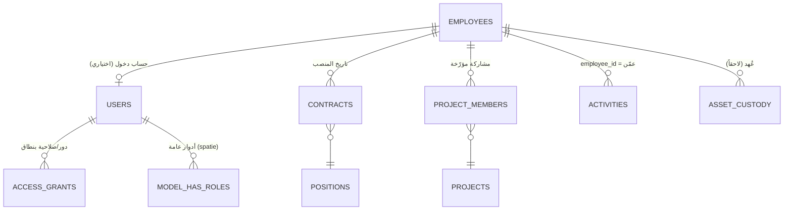

# HC-Hub — التصميم المستهدف (مقترح، 2026-11-16)

هذا تصميم **مقترح** ضمن [القرارات D0–D13](decisions.md). لم يتغيّر شيء في الكود ولا في القاعدة.
كل جدول أو عمود جديد هنا **إضافي** (لا يحذف شيئاً موجوداً)، ولكل migration دالة `down()`.

## 1. المعمارية الموحّدة

**النوع:** modular monolith. تطبيق واحد، قاعدة واحدة، وحدات بحدود واضحة. بدون microservices.

```
        الوحدات المستقبلية (Assets, Procurement, Media)
                     │
        ┌────────────┴────────────┐
   modules/Hr              modules/Tracking
        └────────────┬────────────┘
                     ▼
   modules/Core  (users, programs, cities, centers)
                     ▼
   app/  المنصة (auth, permissions, activity, notifications, media, Desk, registry)
```

### اتجاه الاعتماد المسموح (D10)

| من | مسموح أن يستورد | ممنوع |
| --- | --- | --- |
| `app/` | Laravel + العقود الخاصة به | موديلات `Hr` و `Tracking` مباشرة (يصل إليها عن طريق الـ registry) |
| `Core` | `app/` | `Hr`, `Tracking` |
| `Hr` | `Core`, `app/` | `Tracking` |
| `Tracking` | `Core`, `app/` | `Hr` في الكود الجديد |
| وحدة جديدة | `Core`, `app/` | أي وحدة أخرى مباشرة |

- **الوضع الحالي:** `Tracking → Hr` فيه 66 استيراداً (أغلبها `Employee`). لن تُكسر الآن. تُسجَّل كـ baseline في الاختبار المعماري، والرقم مسموح له أن ينخفض فقط.
- **كسر الحلقة:** `Employee.php` يستورد 5 موديلات من Tracking. هذه العلاقات تنتقل إلى جهة Tracking (`Relation::resolveRelationUsing` من `TrackingServiceProvider`، أو query في جهة Tracking).
- **الحماية:** اختبارات Pest arch تفشل إذا عاد استيراد ممنوع.

### عقد الوحدة (registry)

كل وحدة تسجّل نفسها من الـ `ServiceProvider` الخاص بها. المنصة تقرأ من السجل، ولا تعرف أسماء الوحدات.

| نقطة التوسعة | ماذا تسجّل الوحدة | بديل عن |
| --- | --- | --- |
| Nav destinations | صفحاتها + شرط الصلاحية + المجموعة (حسب العمل) | الاستيراد اليدوي لـ `HrDestinations` |
| Desk panels | البطاقات + التخطيط الافتراضي لكل دور | الاستيراد اليدوي لـ `HrPanels` |
| Search providers | سجلات قابلة للبحث، مفلترة بالصلاحية | بحث يغطي Tracking فقط |
| `TimelineSource` | أحداث مؤرّخة عن شخص أو مشروع | — (جديد) |
| `WorkItemSource` | البنود التي تنتظر المستخدم | `hr.inbox` + `needs` + `reviews` |
| Schedules | المهام المجدولة | `routes/console.php` + `HrServiceProvider` |
| Permission groups | مجموعات الصلاحيات في الكتالوج | صلاحيات HR القادمة من الاستيراد |
| Notification modules | اسم الوحدة + خريطة المستلمين + الكتم | `leaves` و `recruitment` الغائبتان |
| Indicator definitions (إضافة، انظر القسم 9) | تعريف المؤشر الخاص بها | حساب الرقم نفسه في مكانين |

```php
interface TimelineSource
{
    /** @return list<class-string> أنواع الكيانات التي يغطيها: Employee, Project */
    public function subjects(): array;

    /** @return iterable<TimelineEvent> مرتّبة من الأحدث، ومفلترة بصلاحية $viewer */
    public function eventsFor(Model $subject, User $viewer, ?CarbonInterface $before, int $limit): iterable;
}

interface WorkItemSource
{
    /** @return iterable<WorkItem> key, title, module, url, dueAt, priority */
    public function itemsFor(User $user): iterable;

    public function countFor(User $user): int;
}
```

## 2. نموذج الهوية (D1, D2)

**القاعدة:** الموظف هو الشخص. الحساب والعضوية والعهدة هي **علاقات** على الموظف.
جدول `people` مؤجَّل بقرار المستخدم (2026-11-16): لا يوجد اليوم أشخاص خارجيون يجب تسجيلهم.



| الكيان | ماذا يمثّل | المالك |
| --- | --- | --- |
| `employees` | الشخص: هويته وبياناته وعلاقة توظيفه | Hr |
| `users` | الدخول إلى النظام | Core |
| `project_members` | المشاركة في مشروع | Tracking |
| `access_grants` | سلطة في سياق محدد | المنصة |

### ضبط الجسر بين الحساب والموظف (D2)

أعمدة جديدة: `users.is_system` (bool)، `employees.archived_at`. وقيد: `users.employee_id` unique.

| الحالة | القاعدة |
| --- | --- |
| حساب بلا موظف | `is_system = true` صراحةً، بدل قاعدة "null يعني حساب نظام". |
| الموظف الذي له حسابان | يُلغى أحد الحسابين (قرار 2026-11-16). تحديد أيهما بعد تقرير البند 0.4، ثم قيد الـ unique. |
| موظف بلا حساب (23) | مقبول. الحساب ليس شرطاً. تقرير يصنّفهم (مسودة أم فشل صامت). |
| مغادرة الموظف | أرشفة (`archived_at`)، لا حذف نهائي. التاريخ يبقى. |
| متقدّم للتوظيف | يبقى في `recruitment_applicants`، ويرتبط بالموظف عند التعيين كما هو اليوم. |
| الأقارب، جهات اتصال المانحين | يبقون كما هم. |

**إعادة تسمية (D2):** `projects.user_id` ← `owner_employee_id`، و `milestones.responsible_user_id` ← `responsible_employee_id`. تُنفَّذ على مرحلتين (عمود جديد + نسخ، ثم حذف القديم) حتى لا ينكسر شيء.

### `people` — مؤجَّل

- **شرط التفعيل:** ظهور أول شخص خارجي (مستشار، مدرّب، شريك) يجب تسجيله دون عقد عمل.
- **طريقة الإضافة:** جدول `people` في Core يُملأ 1:1 من `employees`، ثم عمود `person_id` بجانب `employee_id` في الجداول التي تحتاجه. لا إعادة ترقيم ولا حذف.
- **قواعد المطابقة حينها:** لا دمج على الاسم وحده، ولا دمج تلقائي. المرشّحون للمطابقة (الرقم الوطني، أو البريد الإلكتروني + الهاتف بعد التطبيع) **اقتراحات** تحتاج تأكيداً بشرياً.
- **ما نفعله الآن لتسهيل ذلك:** تسمية أعمدة المسؤولية كلها `*_employee_id`، وحصر قراءة "من هو هذا الشخص" في مكان واحد (`EmployeeProfile`).

## 3. دورة الحياة والخط الزمني (D6)

**لماذا لا يكفي `activities` وحده؟** لأنه يُحذف بعد `retention.activity_years`. تاريخ الشخص يجب أن يبقى دائماً.
**الحل:** الخط الزمني يُقرأ من الجداول المؤرّخة الدائمة. `activities` يكمّل التفاصيل الحديثة فقط.

| الحدث | الجدول المصدر | الوحدة |
| --- | --- | --- |
| انضم إلى المؤسسة / غادر | `employees.joined_at`, `offboarding_journeys` | Hr |
| استلم منصباً / تغيّر منصبه / انتهى | `contracts`, `contract_amendments` | Hr |
| تجديد، تعريف | `renewal_journeys`, `onboarding_journeys` | Hr |
| إجازة موافق عليها | `leave_requests` | Hr |
| تقييم، دورة | `evaluations`, `courses` | Hr |
| استلم/أعاد معدات | `checklists`, `employee_items` | Hr (لاحقاً Assets) |
| شارك في مشروع / انتهت مشاركته | `project_members` | Tracking |
| أصبح مسؤولاً عن حقل | `assignments` | Tracking |
| إشراف | `supervisions` (+ `starts_on`, `ends_on`, `ended_by`) | Tracking |
| مُنح دوراً في سياق / سُحب منه | `access_grants` | المنصة |

### شكل الحدث (`TimelineEvent`)

| الحقل | المعنى |
| --- | --- |
| `what` | مفتاح الحدث (مثلاً `contract.started`) |
| `subject` | الكيان المتأثر (شخص أو مشروع) |
| `actor` | من نفّذ الإجراء (`user`) |
| `occurredAt` | التاريخ الفعلي (وليس تاريخ الإدخال) |
| `module` | الوحدة المصدر |
| `changes` | القيمة القديمة والجديدة، عند الحاجة |
| `related` | روابط إلى السجلات المرتبطة |

- **الأثر الموحّد للموافقات (D9):** من، متى، القرار، الملاحظة — بالشكل نفسه في كل الوحدات.
- **`activities.employee_id`:** عمود جديد ("عن من")، مفهرس. يجعل سجل الموظف query واحدة.
- **تغييرات `Position`:** تُسجَّل بـ `RecordsActivity` حتى لا يمحو تعديل المنصب الماضي (D3).
- **الـ component:** نوسّع `resources/views/components/activity/⚡timeline.blade.php` الموجود. يأخذ `subject`، ويجمع من كل `TimelineSource` مسجّل، مع ترقيم صفحات بالتاريخ. الـ component نفسه للشخص وللمشروع.

## 4. علاقات الناس والمشاريع (D4)

### `project_members`

| العمود | النوع | ملاحظة |
| --- | --- | --- |
| `id` | bigint PK | |
| `project_id` | FK `projects` restrict | |
| `employee_id` | FK `employees` restrict | |
| `role` | varchar(30) | enum في الكود |
| `starts_on` | date nullable | null = غير معروف (لا نخترع تاريخاً) |
| `ends_on` | date nullable | null = ما زال مستمراً |
| `added_by`, `ended_by` | FK `users` nullable | |
| `source` | varchar(20) | `manual`, `inferred` |
| `is_open` | generated | `1` إذا كان `ends_on` null، وإلا null |

- **Indexes:** `(project_id, ends_on)`، `(employee_id, ends_on)`.
- **Unique:** `(project_id, employee_id, role, is_open)` ← صف مفتوح واحد لكل دور. الأسلوب نفسه المستخدم في `pair_low/pair_high` في `supervisions`.
- **Check:** `ends_on >= starts_on`.
- **لا يوجد حذف:** إنهاء المشاركة = تعبئة `ends_on`. الحذف فقط لتصحيح خطأ إدخال، ويُسجَّل.
- **الأدوار المقترحة:** `Owner`, `Coordinator`, `Member`, `MealOfficer`, `FinanceOfficer`, `Trainer`, `Consultant`, `Volunteer`.
- **مهم:** العضوية **وصف** للمشاركة. لا تمنح صلاحية بمفردها. الصلاحية تبقى في الـ policies و `access_grants`.
- **التعبئة الأولية:** من `projects.user_id` (Owner) و `milestones`/`task_assignees` (Member)، كلها `source = inferred` و `starts_on = null`.
- **نقل الموظف:** لا يمسّ `project_members`. التاريخ يبقى.

### كيف نجيب عن الأسئلة

| السؤال | المصدر |
| --- | --- |
| في أي مشاريع يعمل الشخص الآن؟ | `project_members` حيث `employee_id = ?` و `ends_on` null |
| في أي مشاريع عمل سابقاً؟ | الجدول نفسه، `ends_on` ليس null |
| من في المشروع؟ ومن أي أقسام؟ | `project_members` ← `employees` ← العقد الفعّال ← `positions.department_id` |
| ما مسؤولياته الحالية؟ | `assignments` (acknowledged) + `project_members` المفتوحة + `access_grants` الفعّالة |
| ماذا أنجز؟ | `tasks` المنتهية عن طريق `task_assignees` |
| ما عُهدته؟ | `checklists` / `employee_items` (لاحقاً Assets) |
| تاريخه الكامل؟ | الخط الزمني (القسم 3) |

## 5. الهيكل التنظيمي (D3)

| المحور | الشجرة | المالك | يجيب عن |
| --- | --- | --- | --- |
| المكان | `City > Center` | Core | أين؟ |
| البرنامج | `Strategy > Pillar > Program > Project` | `Program` لـ Core، والباقي لـ Tracking | في أي عمل؟ |
| الوظيفة | `Department` (مسطّح) | Hr | أي اختصاص؟ |
| خط الإدارة | `Position > Position` (مباشر + فني) | Hr | من مديره؟ |

**توضيح عن البرنامج:** يوجد جدول واحد `programs` وموديل واحد `Modules\Core\Models\Program`. لا يوجد موديل Program في Tracking ولا في Hr.
- **الملكية:** Core، لأن الوحدتين تعتمدان عليه.
- **الإدارة:** من شاشات Tracking (`/programs`)، وهو يضيف أعمدته `strategy_id` و `strategic_pillar_id` و `manager_id`. البرنامج يُنشأ من Tracking عند فتح proposal.
- **Hr:** يقرأ فقط (`/hr/programs`) ويستخدم `code` و `positions.program_id`.

**لماذا لا ندمجها في جدول واحد؟**
- قواعدها مختلفة: للمركز دوام وعطل، وللبرنامج استراتيجية ومانح، وللمنصب سقف موظفين.
- `positions` يربط الأربعة معاً أصلاً (`program_id`, `center_id`, `city_id`, `department_id`).
- جدول عام = polymorphic كبير + خسارة الـ FK الحقيقية.

**الناقص فقط:** "مدير القسم" الآن مطابقة اسم `JobLevel` من config. المقترح: عمود `departments.manager_position_id` (FK `positions`, nullable). المنطق القديم يبقى fallback حتى التعبئة.

## 6. الصلاحيات (D5)

- **كتالوج واحد:** مجموعات HR (`employees`, `leaves`, `contracts`, `recruitment-requests`, ...) تُضاف إلى `config/access-control.php` بأسمائها الحالية نفسها. `permissions:sync` يبقى يضيف فقط.
- **توحيد الأدوار:** جدول ربط مؤقت `role_aliases` (`alias`, `role_id`) بدل الجداول المكتوبة في الكود في `HrAccess`. يُزال بعد أن ينتقل كل الكود إلى الاسم الموحّد.
- **الأدوار المكتوبة في الكود** (`MonthlyReportPolicy`, `PlanUpdatePolicy`, ...) تتحوّل إلى صلاحيات مسمّاة، واحدة تلو الأخرى، مع اختبار لكل واحدة.

### `access_grants`

| العمود | النوع | ملاحظة |
| --- | --- | --- |
| `id` | bigint PK | |
| `user_id` | FK `users` | المستفيد |
| `role_id` / `permission_id` | FK nullable | واحد منهما فقط (check) |
| `scope_type` | varchar(30) | `city`, `center`, `program`, `project`, `department` |
| `scope_id` | bigint | |
| `starts_at`, `ends_at` | timestamp | `ends_at` null = مفتوح |
| `granted_by` | FK `users` | |
| `delegated_from_user_id` | FK `users` nullable | للتفويض |
| `revoked_at`, `revoked_by` | nullable | سحب بدون حذف |
| `reason` | varchar(255) nullable | |

- **Index:** `(user_id, scope_type, scope_id, ends_at)`.
- **الأدوار العامة** تبقى في spatie (`model_has_roles`). `access_grants` للسياق فقط.
- **خدمة واحدة:** `AccessScope::allows($user, 'leaves.approve', $center)`. تُرجع true إذا:
  1. كانت لديه الصلاحية عامة (`can()`)، أو
  2. كان لديه grant فعّال (ضمن التاريخ وغير مسحوب) على النطاق نفسه أو نطاق أعلى (مثلاً city يغطي الـ centers التابعة له).
- **الـ policies تستدعي الخدمة.** لا يوجد فحص نطاق مكتوب في الصفحة. الإخفاء في الواجهة ليس حماية.
- **أدوار `HR-<CITY>`:** تصبح دور `HR` واحداً + grant بـ `scope_type = city`. دور `HR-SYR` = `HR` عام.
- **التفويض والوصول المؤقت:** grant بـ `ends_at` + `delegated_from_user_id`. ينتهي تلقائياً، ويظهر في الخط الزمني.
- **محسوم (D5، 2026-11-16):** التوظيف ينتقل إلى جمع صلاحيات كل الأدوار مثل باقي النظام. يسبق التنفيذ جدول "قبل/بعد" يبيّن من يتّسع وصوله.

## 7. الإشعارات وسير العمل (D7, D9)

| البند | المقترح |
| --- | --- |
| مسار واحد | إشعارات HR تمرّ عبر `ActivityRecorder` ← `RecipientResolver` ← `RecipientFilter` ← `AppDatabaseChannel` |
| الوحدات | `leaves`, `recruitment`, `contracts`, `checklists` تُضاف إلى `config/notifications.php` (يصبح الكتم متاحاً فيها) |
| الموضوع | كل إشعار HR يأخذ `subjectType` حقيقياً (بدل `null`) ← رابط + فحص صلاحية |
| منع التكرار | `notification_deliveries` يُدمج في `AlertLedger` (واحد فقط) |
| صندوق "بانتظاري" | صفحة واحدة تجمع كل `WorkItemSource`. `hr.inbox` و `reviews.index` يُحوَّلان إليها (redirect) |
| بريد المرشحين | يبقى مسار HR خاصاً (أشخاص من الخارج، قواعد خصوصية مختلفة) |
| التفضيلات | الكتم حسب الوحدة موجود. التفضيل حسب القناة يُضاف عندما توجد قناة ثانية فعلياً |
| Web Push حقيقي | ليس ضمن هذه المرحلة (لا يوجد `push` listener الآن). نذكره كفجوة فقط |

**سير الموافقات:** لا يوجد محرّك عام. كل workflow (proposal, leave, recruitment, amendment, report) يبقى في الـ Action والـ enum الخاصين به.
الموحّد فقط: **شكل الأثر** في السجل، و**بند العمل** في الصندوق. محرّك التوظيف يُعمَّم عندما تأتي المشتريات كمستهلك ثالث.

## 8. الملفات والبحث

### الملفات (D8)
- **الهدف:** كل الملفات في `media` (مشفّر AES-256-GCM، `MediaCollection` enum).
- **الخطوات:** نسخ من قرص `hr` ← تشفير ← تحقق (العدد + checksum لكل ملف) ← تحويل القراءة ← ترك `hr_media` للقراءة مدة ← أرشفة.
- **الأصل لا يُحذف قبل التحقق.** التراجع = إعادة القراءة إلى `hr_media`.
- **قبل ذلك (D0):** نقل مجلد `../hc-hr/storage/app` إلى داخل التطبيق.
- أنواع الـ morph القديمة (`App\Models\Employee`) تتحوّل إلى مفاتيح الـ morph map.
- فحص الفيروسات (ClamAV) موجود في التوظيف فقط. يصبح خدمة منصة اختيارية لكل عمليات الرفع.

### البحث الشامل
- كل وحدة تسجّل `SearchProvider`: نوع السجل، حقول البحث، الرابط، وشرط الصلاحية.
- HR تسجّل: الموظفين، طلبات الإجازة، طلبات التوظيف. Tracking تنقل البحث الحالي إلى العقد نفسه.
- **الخصوصية:** سجلات الأشخاص يُبحث فيها **على الخادم** وتُفلتر بالصلاحية. لا تُرسل في الفهرس الجاهز إلى المتصفح.
- النتيجة تشير إلى صفحة الموظف الموحّدة (D11).

## 9. التقارير المؤسسية

**القاعدة:** لكل مؤشر **تعريف واحد** تملكه وحدة واحدة. الـ Desk وإحصائيات HR والتقارير تقرأ منه.

- كل وحدة تسجّل تعريفاتها في `IndicatorCatalog` (مفتاح ← query). المؤشرات المشتركة تُبنى من المفاتيح المسجّلة.
- النتائج تحترم الصلاحية (`AccessScope` نفسه).

| المؤشر | التعريف الوحيد | المالك |
| --- | --- | --- |
| موظف فعّال | `Employee::active()` (`is_active` + عقد فعّال) | Hr |
| مشروع فعّال | `Project::active()` (حسب `ProjectStatus`) | Tracking |
| نشاط/مرحلة متأخرة | `Milestone::delayed()` (نفس ما تستخدمه الـ scanners) | Tracking |
| موظفون مشاركون في مشاريع | `project_members` مفتوحة ∩ موظف فعّال | Tracking + Hr |
| مشاريع لكل قسم | `project_members` ← قسم العقد الفعّال | مشترك |
| توزيع الأشخاص على البرامج | `project_members` ← `projects.program_id` | مشترك |
| موافقات معلّقة | مجموع `WorkItemSource::countFor` | المنصة |
| عقود تنتهي قريباً | `Contract::endingWithin($days)` | Hr |

## 10. جاهزية الوحدات المستقبلية

دليل من صفحة واحدة لـ Assets/Inventory، Logistics/Procurement، Media. **لن نبنيها الآن.**

| يجب أن تسجّل | يجب أن تستخدم | ممنوع أن تعيد بناءه |
| --- | --- | --- |
| Nav + Desk panels | `employees` للمسؤول، `users` للفاعل | جدول أشخاص أو مستخدمين |
| Permission group في الكتالوج | `AccessScope` + policies | أدوار أو فحص صلاحيات خاص |
| Notification module | `ActivityRecorder` + `RecordsActivity` | جدول إشعارات أو سجل خاص |
| `TimelineSource` | `media` المشفّر | مخزن ملفات خاص |
| `WorkItemSource` | `cities`, `centers`, `programs`, `departments` | نسخة من الهيكل التنظيمي |
| `SearchProvider` + Schedules | بادئة للروابط والأسماء (D12) | صندوق "بانتظاري" خاص |

- **بذرة Assets:** `checklists` و `employee_items` في HR هي عُهد معدات (العلامة التجارية، الرقم التسلسلي، `delivered_at`). وحدة الأصول تبدأ منها، وتربط العهدة بـ `employee_id`.
- **Procurement:** أول مستهلك ثالث للموافقات ← عندها يُبنى المحرّك المشترك (D9).
- **Media:** تربط المواد بـ `projects` و `employees` عن طريق `media` الموجود، وليس جدولاً جديداً.
- **Migrations:** كل وحدة جديدة تضع الـ migrations الخاصة بها في مجلدها (مثل Hr).

## 11. حوكمة البيانات

### ملكية الكيانات

| الكيان | المالك | من يكتب |
| --- | --- | --- |
| `users`, `cities`, `centers` | Core | Core actions فقط |
| `programs` | Core | Core actions، تُستدعى من شاشات Tracking. Hr يقرأ فقط |
| `employees`, `contracts`, `positions`, `departments`, `leave_*`, `recruitment_*` | Hr | Hr |
| `projects`, `project_members`, `tasks`, `milestones`, `proposals`, `donors` | Tracking | Tracking |
| `activities`, `notifications`, `media`, `access_grants`, `roles`, `permissions` | المنصة | عن طريق خدمات المنصة |

لا تكتب وحدة في جدول وحدة أخرى. تطلب ذلك عن طريق Action أو event.

### التسمية

| النوع | القاعدة | مثال |
| --- | --- | --- |
| مسؤول | `*_employee_id` ← `employees` | `responsible_employee_id`, `project_members.employee_id` |
| فاعل | `*_by` ← `users` | `added_by`, `approved_by` |
| تاريخ فعلي | `*_on` (date) | `starts_on` |
| وقت إجراء | `*_at` (timestamp) | `revoked_at` |

استثناء موجود: `leave_requests.approved_by` و `evaluations.current_manager_id` يشيران إلى `employees`. يُصحَّحان بعد تغطية HR بالاختبارات (D13).

### قواعد التاريخ
- علاقة لها بداية ونهاية ← تواريخ، وليس حذفاً.
- لا يوجد `cascade` على تاريخ شخص. الحذف النهائي لموظف ممنوع (أرشفة، D2).
- تاريخ غير معروف ← `null` + `source = inferred`. لا نخترع بيانات.
- السجل (`activities`) للتفاصيل. الجداول المؤرّخة للحقيقة الدائمة.

### العمليات الحرجة
- داخل `DB::transaction` + قفل صف: إنهاء عقد، تحويل متقدّم إلى موظف، إنهاء عضوية، منح/سحب صلاحية، أي دمج هوية.
- الأحداث والإشعارات تُرسل **بعد** الـ commit (مثل `FanOutActivity` الآن).

### قاعدة الـ migrations
- إضافي أولاً ← تعبئة ← تحقق بتقرير ← تحويل القراءة ← حذف القديم في مرحلة منفصلة.
- لكل migration دالة `down()`. لكل تعبئة أمر تقرير (قراءة فقط) قبلها وبعدها.
